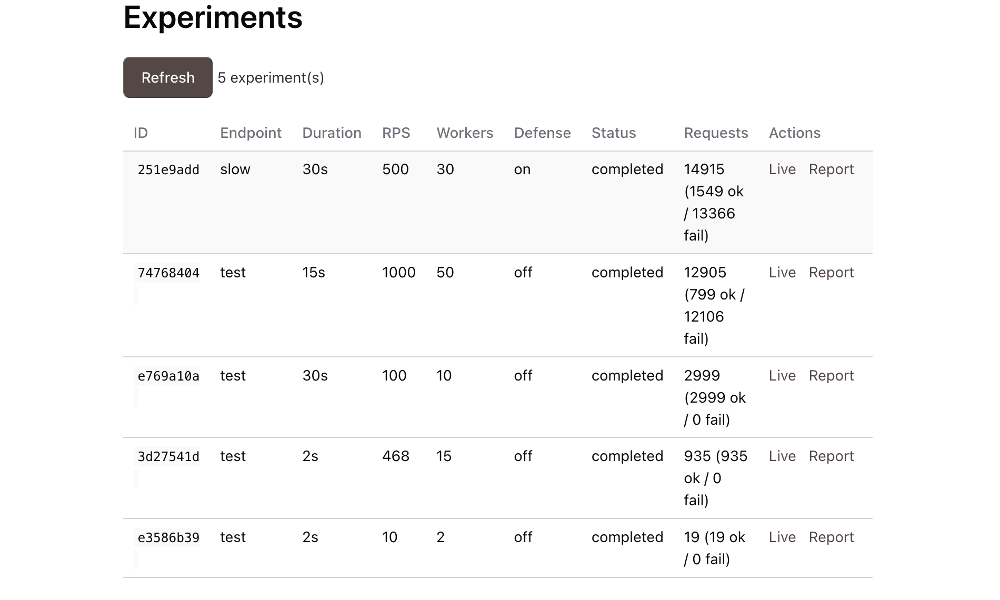
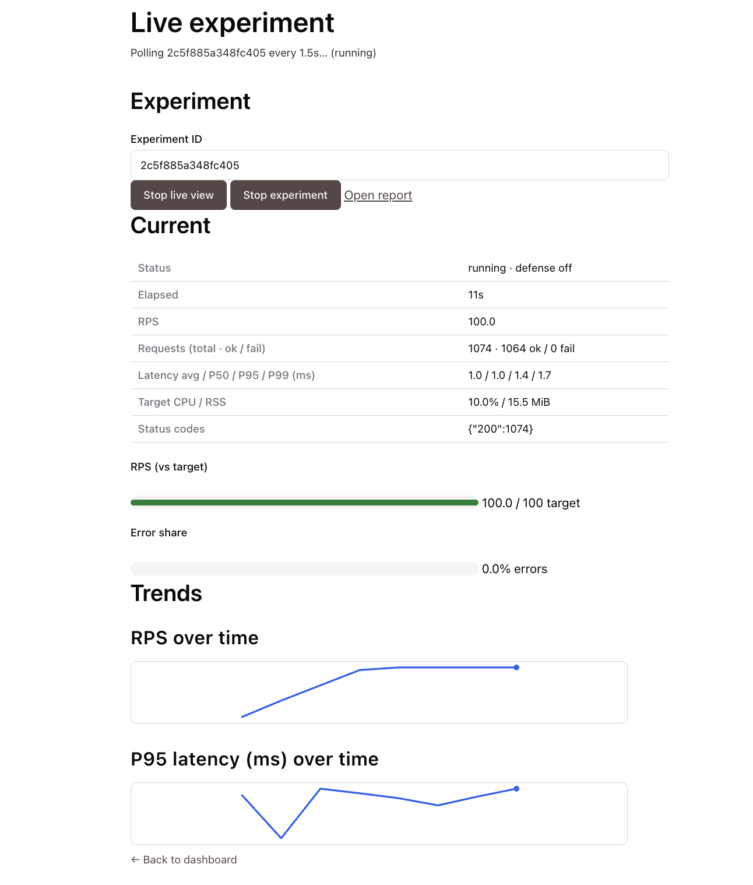
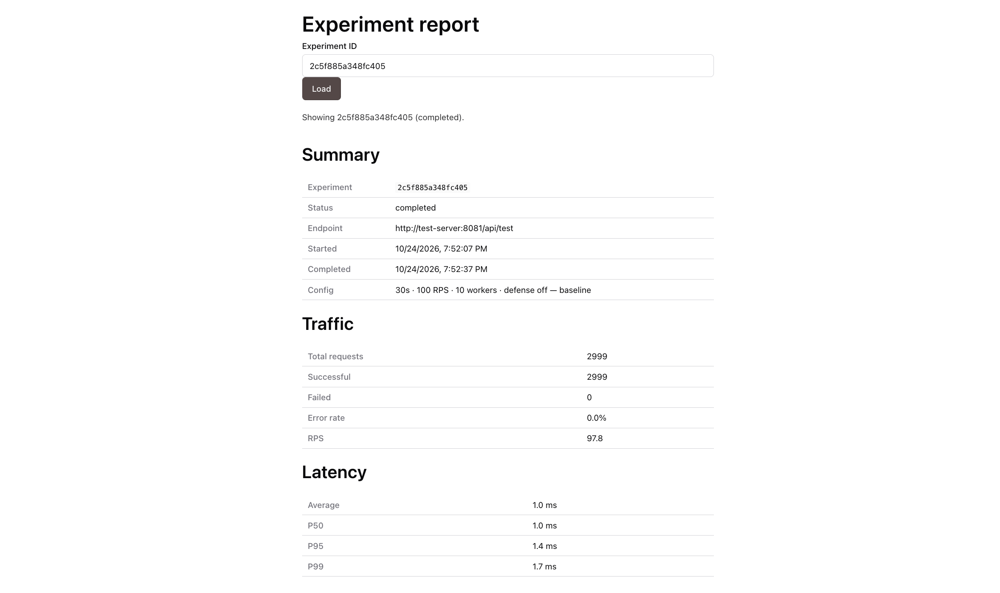
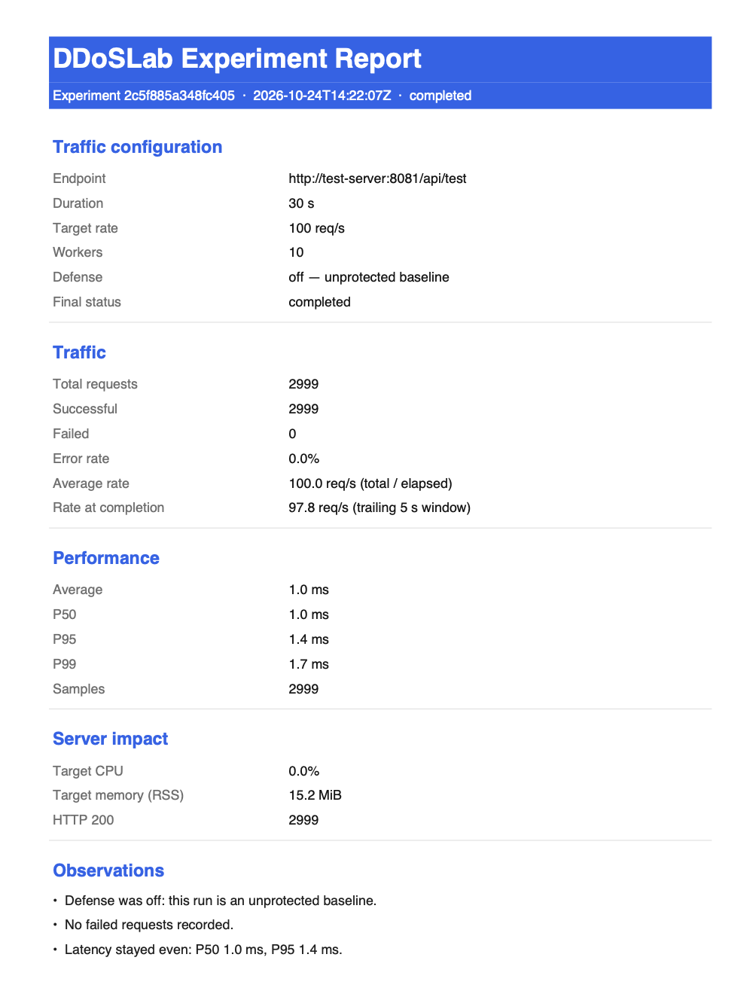
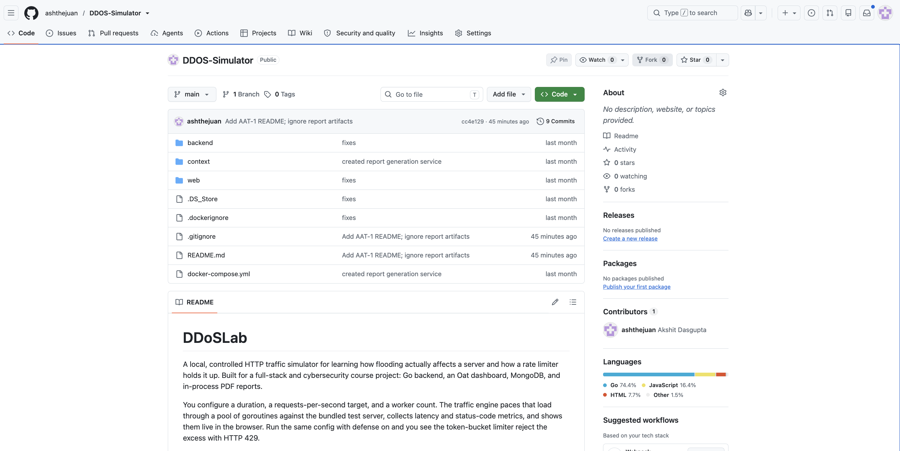

# DDoSLab

A local, controlled HTTP traffic simulator for learning how flooding actually affects a
server and how a rate limiter holds it up. Built for a full-stack and cybersecurity course
project: Go backend, an Oat dashboard, MongoDB, and in-process PDF reports.

You configure a duration, a requests-per-second target, and a worker count. The traffic
engine paces that load through a pool of goroutines against the bundled test server,
collects latency and status-code metrics, and shows them live in the browser. Run the same
config with defense on and you see the token-bucket limiter reject the excess with HTTP 429.

## Objective

Teach the DDoS mechanism from the inside, safely. Real attacks hit real victims, and
production load-testing tooling is overkill for a lab. DDoSLab lets you watch a server
degrade under a controlled flood on your own machine, measure the effect, and compare a
bare run against a defended run.

## Project Description

- A Go binary serves a REST API on `:8080`, the static `web/` dashboard, and optionally the
  test server on `:8081`.
- A worker pool of goroutines fires requests at a configurable rate. A channel-based ticker
  paces the load; a timer or a stop request ends the run cleanly.
- Metrics (total / success / failure, average, P50, P95, P99) stream to the dashboard via
  polling while the experiment runs.
- Finished experiments persist to MongoDB and survive an API restart.
- Defense mode engages a token-bucket rate limiter on the test server for that run, so you
  can compare baseline versus mitigated behavior on identical traffic.

The project deliberately stays local and safe. An allowlist rejects any target outside the
test server, and config caps the load at 300 seconds, 1000 requests per second, and 50
workers.

## Technologies / Tools

| Layer              | Technology                          | Role                                  |
|--------------------|-------------------------------------|---------------------------------------|
| Frontend           | Oat UI, vanilla HTML/CSS/JS         | Dashboard, live metrics, report view  |
| Backend / engine   | Go (goroutines, channels, context)  | API, worker pool, metrics, PDF        |
| Bundled target     | Go HTTP server                      | Receives the simulated load           |
| Database           | MongoDB                             | Persistence of experiments            |
| PDF reports        | gofpdf / Maroto (Go)                | Clean A4 report, no headless browser  |
| Orchestration      | Docker Compose                      | Runs API + MongoDB locally            |

## Directory Layout

```
├── backend/          # Go API, traffic engine, metrics, report, test server
│   ├── cmd/server/        # API entry point
│   ├── cmd/test-server/   # standalone target entry point
│   └── internal/          # experiment, server, report, database packages
├── web/              # Oat static UI (served by Go on :8080)
├── context/          # PRD, build plan, architecture notes
├── docker-compose.yml
└── reports/          # generated experiment PDFs (local artifacts, gitignored)
```

## Execution Steps

Requires Docker and Docker Compose (Go is only needed if you want to build locally).

```bash
git clone https://github.com/ashthejuan/DDOS-Simulator.git
cd DDOS-Simulator
docker compose up --build
```

Open `http://localhost:8080`. Create an experiment:

- Target: `Local Test Server` (default)
- Duration: `60` seconds
- Requests/sec: `200`
- Workers: `10`
- Endpoint: `test`
- Defense: off for a baseline run

Watch the live page poll the metrics endpoint. When the run ends, the run shows in history
and you can download the PDF report. Repeat the same config with Defense on to see the
limiter hold the server up.

## Screenshots

The Experiments page lists past runs with their configs and outcomes, and the Live view
polls the metrics endpoint every second or two while an experiment runs.





Each finished run gets an on-page report and a downloadable PDF report.







## Learning Goals

This is a study project first and a portfolio piece second. It deliberately exercises:
HTTP servers and clients in Go, goroutines and channels, context cancellation, atomic
counters, REST API design, MongoDB persistence, and a small no-build frontend. The defense
mode turns reading about DDoS into watching and measuring it.

## Repository

Written and maintained by Akshit Dasgupta. See the PRD at `context/prd.md` and the build
plan at `context/build-plan.md` for the detailed design.